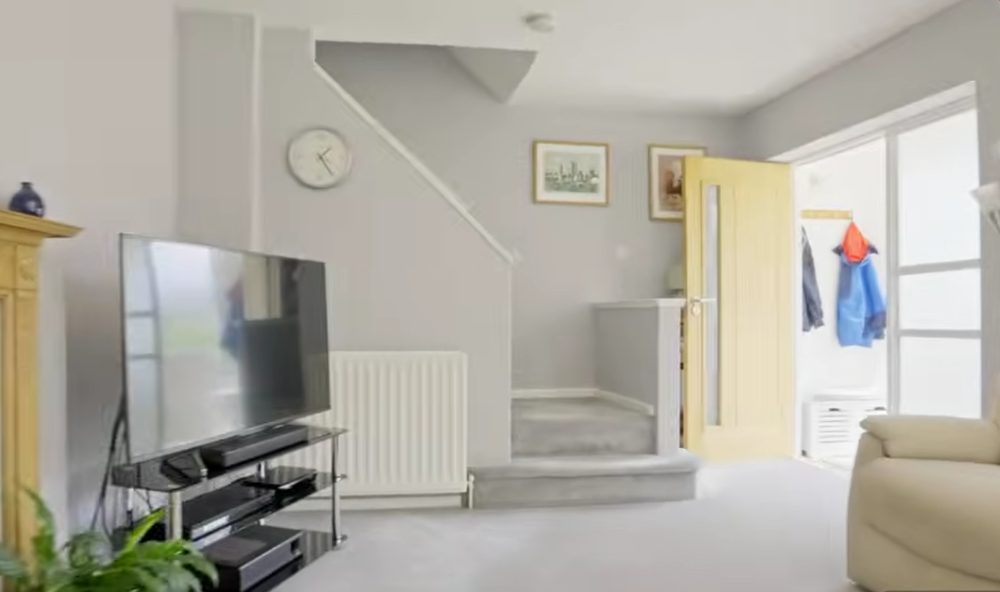
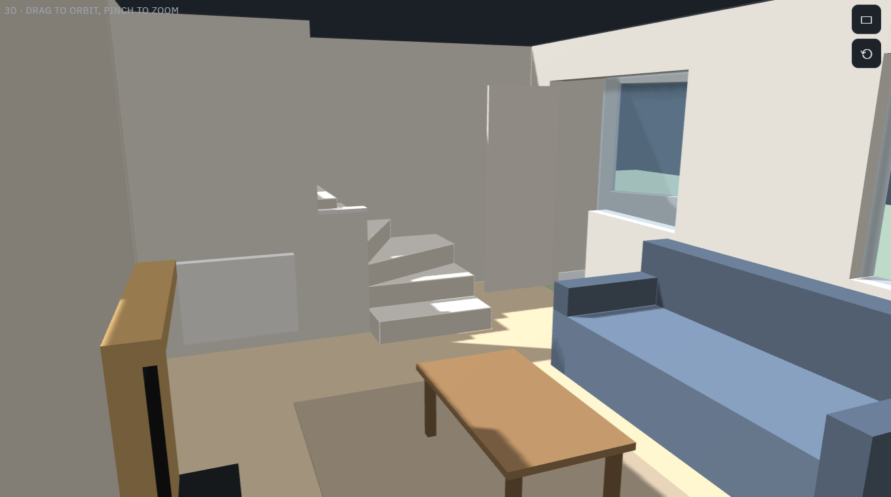

+++
title = "Will the Sofa Fit? Planning Our New Home in 3D with AI"
date = 2026-11-07
draft = false
description = "How I used AI to turn an estate agent's floor plan and a video tour into a 3D layout planner, so my wife and I could try out furniture before buying any."
summary = "We're buying a house we can't go back into before completion, and furnishing it from scratch. In about two hours, without writing any code, I had a 3D planner of it that tells us what fits."

featureImage = "feature.png"

tags = ["AI", "Generative AI", "3D Modelling", "Three.js", "Home", "Interior Design"]
categories = ["Projects"]

showAuthor = true
showTaxonomies = true
showReadingTime = true
showTableOfContents = true
+++


We're buying a house we won't step inside again until just before completion, and we need to furnish it from scratch. I wanted to know what would fit before we spent anything, so I asked AI to build me a 3D model of the place. I didn't write or review a single line of code.


## The problem

Moving house comes with a long list of questions you can't answer from the sofa. Will a king-size bed fit in the main bedroom? Is the dining room big enough for six? Where does the fridge freezer go?

A few things made those questions harder for us. We won't get another viewing before completion. We're buying all our furniture new, so nothing we own has been measured against these rooms. And my wife and I both wanted a say, which meant we needed something we could each open and play with.

What we did have was the estate agent's floor plan, the listing photos and a video tour on YouTube.



---

## Pretty pictures or real measurements?

My first idea came from YouTube. Plenty of creators use AI image tools, Google's "Nano Banana" being a popular one, to turn photos of empty rooms into styled interiors. They look fantastic.

What those tools make, though, is a picture. There's no floor plan underneath it, so sizes drift, a sofa can quietly shrink to fit, and two views of the same room rarely agree. That's fine if you're deciding between green and grey walls. It's no help if you want to know whether the wardrobe door will hit the bed.

So I split the job in two. First, get the layout right with a model that has real measurements. Then, if we fancy it later, make it look nice by running screenshots of that model through an image tool. Layout came first, because that's where the expensive mistakes hide.

---

## How it came together

The whole thing took about two hours, in one conversation with an AI assistant. I described what I wanted in plain English, and it wrote the code and turned it into a web page. I never looked at the code. What came back was a page my wife and I can both open on our phones. Any modern AI chat assistant that can build web pages should manage something similar.

**Starting from the floor plan.** I uploaded the agent's sales brochure. The AI traced the walls, doors, windows and stairs, and worked out the scale from the room sizes printed on the plan. It also spotted that the brochure had copied the utility room's measurements onto two of the bedrooms, which was a nice early sign it was paying attention.

**Checking the proportions.** Agent floor plans usually come with a "not to scale" warning, so we compared every room with the agent's figures. Most landed within a few centimetres, and the total floor area was within a few per cent.



**Filling in the gaps from the video.** A floor plan leaves out a lot. I paused the video tour room by room and sent screenshots, and each one added something new: a radiator here, fitted wardrobes there, the fireplace hearth, a half-height wall between the kitchen and dining room. Small details, but they decide where furniture can actually go.

**Putting it right.** The AI was confident, and sometimes confidently wrong. Take the stairs. Its first attempt had them climbing from the wrong end of the room. I said they start by the front door, so it ran them straight up from the porch, which still wasn't it. When I explained that the bottom steps turn into the living room before the flight heads upstairs, it rebuilt them properly. Then it pointed out that the top of the stairs must pass over a corner of the kitchen, which explained a sloping box in the kitchen ceiling I'd seen in the video and never thought about.


  
  


*Left: a still from the video tour. Right: the same corner in the planner, once the stairs had their turn.*

That became the pattern. I knew the house, the AI knew how to draw it, and a quick comment on whatever looked wrong was usually all it took.

---

## What the planner does

The planner is private, since it's our actual home, so there's no link to share. The screenshots here show how it works. It has two views of each floor, and you can see them side by side.

- **Plan view** is the familiar top-down floor plan. You drag furniture into place, rotate it and change its size. Select a piece and dotted lines show the gap to the nearest wall on each side, in centimetres. There's also a tape measure for checking anything else.
- **3D view** shows the same floor as a dolls' house you can spin around and zoom into. It's where you find out whether a room feels cramped, or whether a tall bookcase blocks the window.



Around those two views:

- **Furniture library.** Around 40 everyday pieces at typical UK sizes, from sofas and beds to a pram. If you've found something specific in a shop, you can add it using the width, depth and height from the product page.
- **Fit checks.** The planner keeps an eye on every piece. Anything overlapping a wall, radiator or hearth turns red. Anything blocking a door, or leaving too little room to get into bed, open a wardrobe or pull out a dining chair, turns amber with a short note explaining why.
- **Layouts.** We can keep several versions side by side, such as "sofa facing the garden" and "sofa facing the fire", and we can both edit them.



---

## Try it yourself


**You'll need:** the estate agent's floor plan (the PDF or a clear photo), plus any listing photos or video tour. Set aside about two hours.


1. **Upload the floor plan** to an AI chat assistant and ask for something like: *"an interactive web page showing this floor plan in 2D and 3D, at real scale, where I can drag furniture around and get a warning when something doesn't fit."*
2. **Check the room sizes** it comes up with against the agent's figures, and ask it to adjust anything that's off.
3. **Send photos room by room** so it can add the things floor plans leave out, like radiators, fitted wardrobes and fireplaces.
4. **Be specific when it gets something wrong.** "The bottom steps turn into the living room" gets a better fix than "the stairs are wrong".
5. **Add the furniture you're considering**, using the sizes from the retailer's product page, and see what the fit checks say.

---

## Key takeaways

1. **No code, still a real tool.** This was a fun, quick and genuinely useful project for me and my family, and I didn't write or review any code. What mattered was describing the house clearly and noticing when something looked off.
2. **Pick the right kind of AI output.** Image generators are great for mood. For decisions that cost money, start with something that has real measurements.
3. **Your knowledge is the missing piece.** The AI turned a PDF into a working 3D planner in under an hour, but it couldn't know how our stairs turn. Pointing at the exact thing that was wrong fixed it fastest.
4. **Try it before you buy it.** Ten minutes moving furniture around a model is a lot easier than sending a sofa back.

Two hours, no code and, with any luck, no returns.
